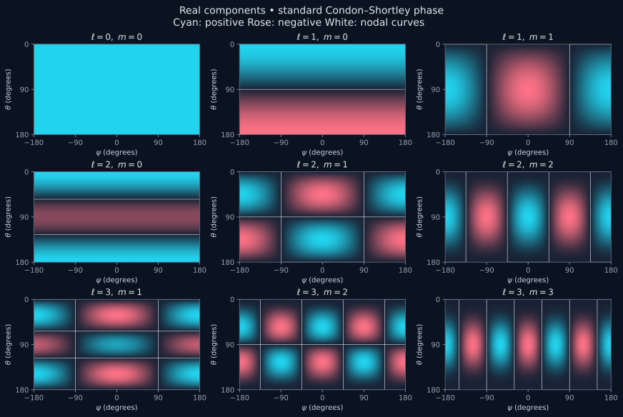
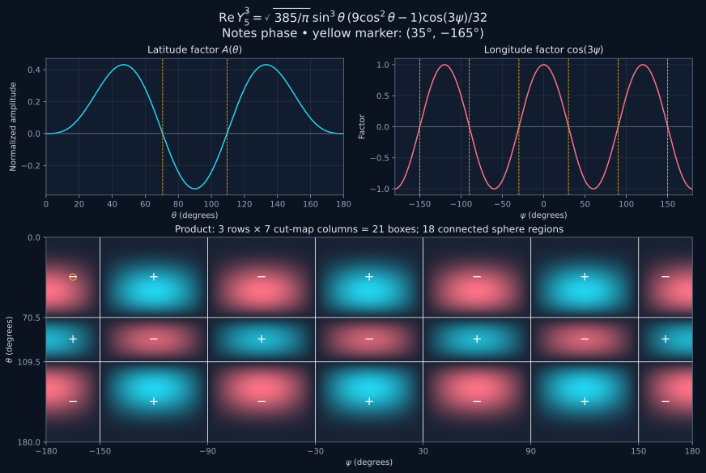
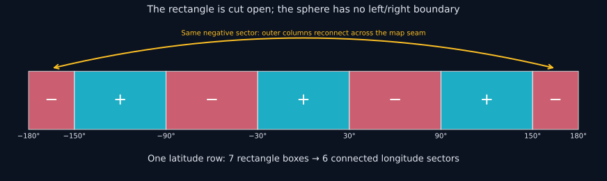
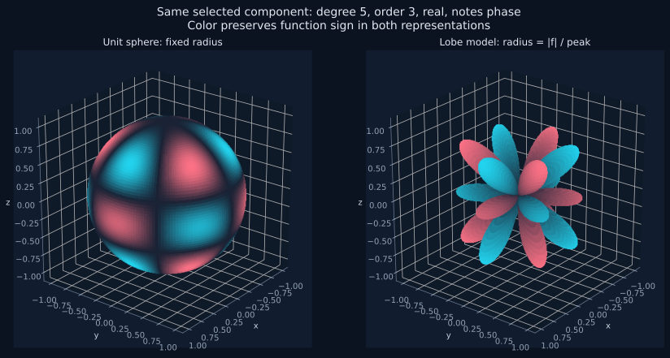

# Spherical harmonics, from the beginning

## A complete learning guide to the Physics Lab explorer

**Scope:** every allowed degree and order in the explorer, from $\ell=0$ through $64$, including positive and negative orders, real and imaginary components, both phase conventions, normalization, expanded polynomials, nodes, sign regions, numerical evaluation, and the meaning of each plot.

**Prerequisites:** basic algebra. Trigonometry, complex numbers, differentiation, integration, and differential equations are introduced as they become necessary. You can read the geometry and sign sections first, then return to the derivations.

**How to use this document:** work through one section at a time with the [interactive explorer](http://localhost:5173/#/phd-physics/spherical-harmonics) open. Equations use LaTeX between dollar signs; open this Markdown in a viewer with math support. Figures are local SVG files in `figures/`.

**Companion reference:** [The complete degree/order atlas](./all-degree-order-pairs.md) lists explicit normalized formulas for **all 4,225 signed pairs** supported by the explorer, plus latitude nodes, longitude nodes, region counts, and a first-region sign test. The guide explains the reasoning; the atlas applies that reasoning to every pair. Separate sections for thousands of almost identical derivations would conceal the common structure, so this guide derives a reusable procedure and the atlas supplies every result.

Markdown has no fixed pages. At an ordinary print size, the guide is a substantial chapter; the exhaustive atlas is much longer than 20 pages.

---

## Contents

1. What a spherical harmonic is
2. Coordinates and angles
3. What degree and order mean
4. A short toolkit: factorials, derivatives, integrals, and complex numbers
5. Where the angular equation comes from
6. Why longitude gives sine and cosine
7. Why latitude gives Legendre functions
8. Constructing ordinary Legendre polynomials
9. Constructing associated Legendre functions
10. Normalization, derived
11. Real and imaginary parts, without changing the basis
12. Negative orders and phase conventions
13. A procedure for any chosen degree and order
14. Low-degree examples, derived explicitly
15. The complete degree-five, order-three example
16. Finding actual latitude nodes
17. Finding longitude nodes and counting columns
18. Rectangle boxes versus connected sphere regions
19. Determining signs, including the top-left box
20. Understanding the map, sphere, and lobe plots
21. Poles, seams, zero components, and numerical zeros
22. Stable evaluation through degree 64
23. Exact symbolic expansion and its numerical limitations
24. How linked selection works
25. Electromagnetic and quantum applications
26. Guided experiments
27. Exercises with worked answers
28. Verification, implementation map, and sources

---

## 1. What a spherical harmonic is

Imagine covering a globe with a number at every point. A temperature map does this: each location has a temperature. A spherical harmonic is also a number-valued pattern on a globe, but its pattern is specified by a mathematical rule rather than measurements.

A real-valued component can be positive at one place, negative at another, and zero along boundaries between them. The explorer uses cyan for positive values, rose for negative values, and a dark neutral color at zero. A **node** is a place where the selected function is zero.

The word **harmonic** has a connection to familiar waves. On a circle, sine and cosine form repeating patterns. On a sphere, spherical harmonics play the corresponding role. They form a family of angular building blocks from which more complicated fields can be assembled.

A spherical harmonic is not automatically a star, an electron, an electric charge distribution, or a vibrating object. It is a mathematical angular function. A physical model supplies its interpretation.

The explorer begins with a complex-valued function:

$$
Y_\ell^m(\theta,\psi).
$$

It displays either its real part or its imaginary part:

$$
f(\theta,\psi)=\operatorname{Re}Y_\ell^m(\theta,\psi)
\quad\text{or}\quad
f(\theta,\psi)=\operatorname{Im}Y_\ell^m(\theta,\psi).
$$

The superscript $m$ is an **index**, not an instruction to raise $Y$ to a power. Likewise, the subscript $\ell$ labels the degree. Conventional notation is $Y_\ell^m$; your notes use $Y_m^\ell$ for the same degree/order pair. Always check which index a source calls degree.

## 2. Coordinates and angles

### 2.1 The two angles

A point on a unit sphere is located by:

- **Colatitude** $\theta$: angle downward from the north pole, from $0$ to $\pi$ radians, or $0^\circ$ to $180^\circ$.
- **Azimuth** $\psi$: angle around the vertical axis. The explorer cuts the circle at $-\pi$ and $\pi$, or $-180^\circ$ and $180^\circ$.

Many textbooks call azimuth $\varphi$ or $\phi$. Here we use $\psi$ consistently.

Colatitude is not geographical latitude. If geographical latitude is $b$, then

$$
b=90^\circ-\theta.
$$

Thus $\theta=0^\circ$ is the north pole, $90^\circ$ the equator, and $180^\circ$ the south pole.

### 2.2 From angles to a point

For radius one,

$$
x=\sin\theta\sin\psi,\qquad
y=\sin\theta\cos\psi,\qquad
z=\cos\theta.
$$

Here ψ (also written ϕ) increases eastward: London 0°, Kathmandu approximately +85°, and Lexington approximately −84°. The exchanged axes place Greenwich on +y and 90° east on +x.

Why? The vertical projection has length $\cos\theta$. The horizontal projection has length $\sin\theta$. Resolving that horizontal projection along $x$ and $y$ introduces $\cos\psi$ and $\sin\psi$.

Check the radius:

$$
x^2+y^2+z^2
=\sin^2\theta(\cos^2\psi+\sin^2\psi)+\cos^2\theta=1.
$$

Examples:

| Angles | Cartesian point | Meaning |
|---|---|---|
| $\theta=0$, any $\psi$ | $(0,0,1)$ | north pole |
| $\theta=\pi/2$, $\psi=0$ | $(1,0,0)$ | positive $x$ direction |
| $\theta=\pi/2$, $\psi=\pi/2$ | $(0,1,0)$ | positive $y$ direction |
| $\theta=\pi$, any $\psi$ | $(0,0,-1)$ | south pole |

At either pole, all azimuths describe the same physical point. The program keeps your previously chosen azimuth there, but that does not make longitude geometrically defined at a pole.

### 2.3 Degrees and radians

The mathematical functions use radians:

$$
\theta_{\rm rad}=\frac\pi{180}\theta_{\rm deg},\qquad
\psi_{\rm rad}=\frac\pi{180}\psi_{\rm deg}.
$$

For example, $\cos(3\psi)$ at $\psi=30^\circ$ means $\cos(\pi/2)=0$. It does not mean feeding the number $90$ into a routine that expects radians.

## 3. What degree and order mean

Allowed indices are

$$
\ell=0,1,2,\ldots,\qquad m=-\ell,-\ell+1,\ldots,\ell.
$$

It is useful to set

$$
q=|m|.
$$

For the selected real or imaginary component, the two indices control different parts of the geometry:

- $q$ determines how often the longitude factor oscillates.
- $\ell-q$ is the number of interior zeros of the latitude factor.
- The sign of $m$ influences phase/sign relationships, but not the nodal geometry of the corresponding cosine/sine components.

At one degree there are $2\ell+1$ signed orders. Through degree $L$ there are

$$
\sum_{\ell=0}^L(2\ell+1)=(L+1)^2
$$

complex harmonics. Through degree $64$, this is $65^2=4225$. Switching components or phase convention changes how these are displayed; it does not create additional independent complex degree/order pairs.

Common names:

| Case | Name | Geometric feature |
|---|---|---|
| $m=0$ | zonal | no longitude dependence |
| $0<|m|<\ell$ | tesseral | both latitude and longitude divisions |
| $|m|=\ell>0$ | sectoral | longitude sectors, no interior latitude nodes |

These names describe patterns. They do not replace the formulas.



*Each panel uses its own amplitude scale. All examples in this figure use the standard phase and real component. Comparisons of color strength between panels are therefore comparisons of shape, not absolute normalization.*

## 4. A short mathematical toolkit

### 4.1 Factorials

For a nonnegative integer $n$,

$$
n!=n(n-1)\cdots2\cdot1,\qquad0!=1.
$$

For example $4!=24$. Factorials appear in the exact polynomial coefficients and normalization. The condition $q\le\ell$ ensures factorial arguments such as $\ell-q$ are nonnegative.

### 4.2 Derivatives

A derivative measures how a function changes. For integer powers,

$$
\frac d{dx}x^n=nx^{n-1}.
$$

Repeated differentiation gives

$$
\frac{d^q}{dx^q}x^n=
\frac{n!}{(n-q)!}x^{n-q}\quad(n\ge q).
$$

If $n<q$, repeated differentiation makes the term zero. This fact explains the stopping point of the finite sum later.

### 4.3 Integrals

An integral adds contributions over a continuous interval. A surface integral on the sphere includes an area factor. A small angular patch has area

$$
d\Omega=\sin\theta\,d\theta\,d\psi
$$

on the unit sphere. The $\sin\theta$ matters: equal rectangles in the angular map do not have equal physical areas on the sphere. A patch near a pole is smaller than the same angular rectangle at the equator.

For radius $R$, surface area is $R^2d\Omega$. The full solid angle is

$$
\int_{-\pi}^{\pi}\int_0^\pi\sin\theta\,d\theta\,d\psi=4\pi.
$$

### 4.4 Complex numbers

The imaginary unit satisfies $i^2=-1$. A complex number has the form $a+ib$. Its real and imaginary parts are $a$ and $b$. Its conjugate is $a-ib$, and its squared magnitude is $a^2+b^2$.

Euler’s identity connects complex exponentials to ordinary trigonometry:

$$
e^{i\alpha}=\cos\alpha+i\sin\alpha.
$$

Therefore

$$
e^{im\psi}=\cos(m\psi)+i\sin(m\psi).
$$

No unexplained imaginary values need to be placed on the screen: selecting a component gives an ordinary real number.

## 5. Where the angular equation comes from

Spherical harmonics arise when equations with spherical geometry are separated into radial and angular parts. Electrostatic potential outside charges is a useful example:

$$
\nabla^2V=0.
$$

In spherical coordinates,

$$
\nabla^2V=
\frac1{r^2}\frac\partial{\partial r}\left(r^2\frac{\partial V}{\partial r}\right)
+\frac1{r^2\sin\theta}\frac\partial{\partial\theta}
\left(\sin\theta\frac{\partial V}{\partial\theta}\right)
+\frac1{r^2\sin^2\theta}\frac{\partial^2V}{\partial\psi^2}.
$$

Try a product

$$
V(r,\theta,\psi)=R(r)Y(\theta,\psi).
$$

Substitute, multiply by $r^2$, and divide by $RY$ where the factors are nonzero. The radial expression depends only on $r$ and the angular expression only on angles. For the sum to vanish for all independent variables, each must equal a constant with opposite signs.

Write that constant as $\lambda$. The angular equation becomes

$$
\frac1{\sin\theta}\frac\partial{\partial\theta}
\left(\sin\theta\frac{\partial Y}{\partial\theta}\right)
+\frac1{\sin^2\theta}\frac{\partial^2Y}{\partial\psi^2}
=-\lambda Y.
$$

The operator on the left is the angular Laplacian, also called the Laplace–Beltrami operator on the unit sphere. Requiring a globally regular solution ultimately gives

$$
\lambda=\ell(\ell+1).
$$

Thus spherical harmonics satisfy

$$
\nabla^2_{S^2}Y_\ell^m=-\ell(\ell+1)Y_\ell^m.
$$

The minus sign is part of this operator convention. Degree measures an angular spatial frequency through this eigenvalue.

## 6. Why longitude gives sine and cosine

Separate once more:

$$
Y(\theta,\psi)=\Theta(\theta)\Phi(\psi).
$$

Substitution into the angular equation and division by $\Theta\Phi$ yields

$$
\frac1{\Theta\sin\theta}\frac d{d\theta}
\left(\sin\theta\frac{d\Theta}{d\theta}\right)
+\frac1{\Phi\sin^2\theta}\frac{d^2\Phi}{d\psi^2}
=-\lambda.
$$

Multiplying by $\sin^2\theta$ isolates the longitude expression. Choose its separation constant as $-m^2$:

$$
\frac{d^2\Phi}{d\psi^2}+m^2\Phi=0.
$$

Solutions are sine, cosine, or their complex combination $e^{im\psi}$. A trip around the sphere must return the same value:

$$
\Phi(\psi+2\pi)=\Phi(\psi).
$$

For the exponential this requires $e^{i2\pi m}=1$, so $m$ is an integer. This is the reason integer orders appear; they are not arbitrary slider labels.

For $m=0$, the general local ODE solution is $A+B\psi$, but periodicity forces $B=0$. The longitude dependence is constant.

## 7. Why latitude gives Legendre functions

The remaining equation is

$$
\frac1{\sin\theta}\frac d{d\theta}
\left(\sin\theta\frac{d\Theta}{d\theta}\right)
+\left[\lambda-\frac{m^2}{\sin^2\theta}\right]\Theta=0.
$$

Set $u=\cos\theta$. Then

$$
\frac{du}{d\theta}=-\sin\theta,
\qquad
\frac d{d\theta}=-\sin\theta\frac d{du}.
$$

Applying this substitution carefully gives

$$
(1-u^2)\frac{d^2\Theta}{du^2}
-2u\frac{d\Theta}{du}
+\left[\lambda-\frac{m^2}{1-u^2}\right]\Theta=0.
$$

This is the associated Legendre equation. Its regular solutions for integer degree use $\lambda=\ell(\ell+1)$ and $q=|m|\le\ell$.

One way to see the degree restriction is to factor out the endpoint behavior:

$$
\Theta(u)=(1-u^2)^{q/2}v(u).
$$

The equation for $v$ becomes

$$
(1-u^2)v''-2(q+1)uv'
+[\lambda-q(q+1)]v=0.
$$

If a polynomial solution has highest power $u^n$, collecting its highest-power terms requires

$$
\lambda-q(q+1)=n(n+2q+1).
$$

Therefore

$$
\lambda=(n+q)(n+q+1).
$$

Writing $\ell=n+q$ explains both $\lambda=\ell(\ell+1)$ and $n=\ell-q\ge0$. The full regular endpoint eigenvalue problem selects this discrete family; a polynomial leading-term argument alone is not a proof that all other local solutions are singular. The important practical result is that smooth, single-valued functions on the full sphere use this family.

## 8. Constructing ordinary Legendre polynomials

Start with Rodrigues’ formula:

$$
P_\ell(u)=\frac1{2^\ell\ell!}
\frac{d^\ell}{du^\ell}(u^2-1)^\ell.
$$

### 8.1 Degree zero

$$
P_0(u)=1.
$$

### 8.2 Degree one

$$
P_1(u)=\frac12\frac d{du}(u^2-1)=u.
$$

### 8.3 Degree two

Expand, differentiate twice, and divide:

$$
(u^2-1)^2=u^4-2u^2+1,
$$

$$
\frac{d^2}{du^2}(u^4-2u^2+1)=12u^2-4,
$$

$$
P_2(u)=\frac{12u^2-4}{2^2\,2!}
=\frac12(3u^2-1).
$$

### 8.4 A useful list

$$
\begin{aligned}
P_0(u)&=1,\\
P_1(u)&=u,\\
P_2(u)&=\tfrac12(3u^2-1),\\
P_3(u)&=\tfrac12(5u^3-3u),\\
P_4(u)&=\tfrac18(35u^4-30u^2+3),\\
P_5(u)&=\tfrac18(63u^5-70u^3+15u).
\end{aligned}
$$

These are not normalized spherical harmonics yet. They are the raw latitude building blocks for order zero.

### 8.5 Deriving the finite polynomial sum

Use the binomial theorem:

$$
(u^2-1)^\ell=\sum_{k=0}^{\ell}
(-1)^k\frac{\ell!}{k!(\ell-k)!}u^{2\ell-2k}.
$$

Differentiate $\ell$ times. Terms with $2\ell-2k<\ell$ vanish. For the others, use the repeated-derivative rule:

$$
P_\ell(u)=\frac1{2^\ell}
\sum_{k=0}^{\lfloor\ell/2\rfloor}
\frac{(-1)^k(2\ell-2k)!}
{k!(\ell-k)!(\ell-2k)!}u^{\ell-2k}.
$$

This is a finite, explicit formula for every nonnegative integer degree.

## 9. Constructing associated Legendre functions

For nonnegative order $q$, the standard Condon–Shortley definition is

$$
P_\ell^q(u)=(-1)^q(1-u^2)^{q/2}
\frac{d^qP_\ell(u)}{du^q}.
$$

Inside the physical angular domain, $0\le\theta\le\pi$, we have $\sin\theta\ge0$. Therefore

$$
(1-\cos^2\theta)^{q/2}=\sin^q\theta.
$$

Hence

$$
P_\ell^q(\cos\theta)
=(-1)^q\sin^q\theta
\left.\frac{d^qP_\ell(u)}{du^q}\right|_{u=\cos\theta}.
$$

The factor $(-1)^q$ is the Condon–Shortley phase. It changes the sign for odd $q$ and leaves even $q$ unchanged.

Although the name says “associated Legendre polynomial,” for odd $q$ the function of $u$ includes a square-root power $(1-u^2)^{q/2}$. The derivative factor is a polynomial; the full associated function need not be a polynomial in $u$. In angular form it is a power of sine times a polynomial in cosine.

Differentiate the finite sum in Section 8 another $q$ times:

$$
\boxed{
P_\ell^q(\cos\theta)=
\frac{(-1)^q\sin^q\theta}{2^\ell}
\sum_{k=0}^{\lfloor(\ell-q)/2\rfloor}
\frac{(-1)^k(2\ell-2k)!}
{k!(\ell-k)!(\ell-q-2k)!}
\cos^{\ell-q-2k}\theta.
}
$$

This is the formula used to expand the selected harmonic symbolically. There is no unevaluated $P_\ell^q$ left after the finite sum is carried out.

Why does the upper limit change? A term originally proportional to $u^{\ell-2k}$ survives $q$ derivatives only if $\ell-2k\ge q$.

## 10. Normalization, derived

A normalized complex harmonic has total squared magnitude one:

$$
\int_{S^2}|Y_\ell^m|^2\,d\Omega=1.
$$

For $m=q\ge0$, write

$$
Y_\ell^q=N_{\ell q}P_\ell^q(\cos\theta)e^{iq\psi}.
$$

Because $|e^{iq\psi}|^2=1$, the longitude integral contributes $2\pi$. With $u=\cos\theta$, the latitude integral becomes

$$
\int_{-1}^{1}[P_\ell^q(u)]^2\,du
=\frac2{2\ell+1}\frac{(\ell+q)!}{(\ell-q)!}.
$$

Here is a route to that factorial ratio. Set

$$
J_{\ell q}=\int_{-1}^1(1-u^2)^q[P_\ell^{(q)}(u)]^2\,du,
$$

where parentheses mean an ordinary derivative, not associated order. Differentiate the ordinary Legendre ODE $q-1$ times to obtain

$$
(1-u^2)P_\ell^{(q+1)}-2quP_\ell^{(q)}
+[\ell(\ell+1)-q(q-1)]P_\ell^{(q-1)}=0.
$$

Equivalently,

$$
\frac d{du}[(1-u^2)^qP_\ell^{(q)}]
=-(\ell+q)(\ell-q+1)(1-u^2)^{q-1}P_\ell^{(q-1)}.
$$

Integrate $J_{\ell q}$ by parts once. The boundary term vanishes because $(1-u^2)^q=0$ at the endpoints for $q\ge1$. This gives

$$
J_{\ell q}=(\ell+q)(\ell-q+1)J_{\ell,q-1}.
$$

Iterating produces

$$
J_{\ell q}=\frac{(\ell+q)!}{(\ell-q)!}J_{\ell0}.
$$

To get $J_{\ell0}$, insert Rodrigues’ formula into $\int P_\ell^2du$ and integrate by parts $\ell$ times. All endpoint terms vanish, and the leading coefficient gives

$$
P_\ell^{(\ell)}=\frac{(2\ell)!}{2^\ell\ell!}.
$$

The remaining elementary integral is

$$
\int_{-1}^1(1-u^2)^\ell du
=\frac{2^{2\ell+1}(\ell!)^2}{(2\ell+1)!}.
$$

For example, it follows by the substitution $u=2t-1$ and the integer beta integral, or repeated integration by parts. Combining the constants gives $J_{\ell0}=2/(2\ell+1)$, completing the norm calculation.

Now solve for $N_{\ell q}$:

$$
1=N_{\ell q}^2\,(2\pi)\,
\frac2{2\ell+1}\frac{(\ell+q)!}{(\ell-q)!},
$$

$$
\boxed{N_{\ell q}=\sqrt{\frac{2\ell+1}{4\pi}\frac{(\ell-q)!}{(\ell+q)!}}.}
$$

For a quick independent check at degree zero, $Y_0^0$ is a constant $C$. Its squared integral is $4\pi C^2$, so $C=1/\sqrt{4\pi}$.

Normalization is an integral condition, not a requirement that the maximum function value equal one. The color map uses a separate display scale.

## 11. Real and imaginary parts, without changing the basis

For $m=q\ge0$, Euler’s identity gives

$$
\operatorname{Re}Y_\ell^q=N_{\ell q}P_\ell^q(\cos\theta)\cos(q\psi),
$$

$$
\operatorname{Im}Y_\ell^q=N_{\ell q}P_\ell^q(\cos\theta)\sin(q\psi).
$$

These two factors make sign reasoning simple: multiply a latitude factor by a longitude factor.

For $q>0$,

$$
\int_{-\pi}^{\pi}\cos^2(q\psi)d\psi
=\int_{-\pi}^{\pi}\sin^2(q\psi)d\psi=\pi.
$$

Each component therefore has squared norm $1/2$, even though the full complex harmonic has norm one:

$$
\int(\operatorname{Re}Y)^2d\Omega
=\int(\operatorname{Im}Y)^2d\Omega=\frac12.
$$

Some references multiply these real functions by $\sqrt2$ to make a normalized **real spherical-harmonic basis**. The explorer does not do that. A coefficient that differs by $\sqrt2$ may indicate a different real-basis normalization, not an error in either source.

For $m=0$, $e^{i0\psi}=1$. Thus

$$
\operatorname{Re}Y_\ell^0=Y_\ell^0,\qquad
\operatorname{Im}Y_\ell^0=0.
$$

The real component then has norm one and the imaginary component norm zero. Do not apply the “one half” statement to order zero.

## 12. Negative orders and phase conventions

### 12.1 Standard negative-order identity

The standard convention is

$$
\boxed{Y_\ell^{-q}=(-1)^q\overline{Y_\ell^q}.}
$$

If $Y_\ell^q=a+ib$, then

$$
\operatorname{Re}Y_\ell^{-q}=(-1)^q a,
\qquad
\operatorname{Im}Y_\ell^{-q}=(-1)^{q+1}b.
$$

This is why negative order must not be implemented simply by replacing $q$ with $-q$ in the trigonometric function and ignoring the latitude prefactor.

For a unified calculation at signed $m$, define

$$
S_m=\begin{cases}1,&m\ge0,\\(-1)^q,&m<0.\end{cases}
$$

Then

$$
Y_\ell^m=S_mN_{\ell q}P_\ell^q(\cos\theta)e^{im\psi}.
$$

### 12.2 The explorer’s notes convention

The alternative convention is explicitly

$$
\boxed{\widetilde Y_\ell^m=(-1)^{|m|}Y_\ell^m}
$$

for **both positive and negative orders**. Define

$$
C_q=\begin{cases}1,&\text{standard},\\(-1)^q,&\text{notes}.
\end{cases}
$$

The active function is $C_qY_\ell^m$. Odd absolute orders reverse all signs when switching conventions; even absolute orders do not change. All zeros remain in the same places.

For positive order, the notes convention cancels the $(-1)^q$ in the associated Legendre definition. For negative order there is also the negative-order identity to respect. “Remove the phase” is ambiguous unless a source states how negative orders are handled. The boxed definition is the precise rule used here.

Because the multiplier is real and depends only on $|m|$, the notes harmonics satisfy the same conjugation identity:

$$
\widetilde Y_\ell^{-q}=(-1)^q\overline{\widetilde Y_\ell^q}.
$$

### 12.3 Complete sign table

Relative to the standard positive-order component:

| Signed order and convention | Real multiplier | Imaginary multiplier |
|---|---:|---:|
| $+q$, standard | $1$ | $1$ |
| $-q$, standard | $(-1)^q$ | $(-1)^{q+1}$ |
| $+q$, notes | $(-1)^q$ | $(-1)^q$ |
| $-q$, notes | $1$ | $-1$ |

This table is for $q>0$. At order zero both phase conventions coincide.

## 13. A procedure for any chosen degree and order

Given $(\ell,m)$:

1. Check that $\ell$ is a nonnegative integer and $|m|\le\ell$.
2. Set $q=|m|$.
3. Construct $P_\ell(u)$ using Rodrigues’ formula or the finite polynomial sum.
4. Differentiate it $q$ times.
5. Replace $u$ by $\cos\theta$ and multiply by $(-1)^q\sin^q\theta$.
6. Multiply by $N_{\ell q}$.
7. For negative $m$, multiply by another $(-1)^q$.
8. For notes phase, multiply by another $(-1)^q$.
9. Multiply by $\cos(m\psi)$ for the real part or $\sin(m\psi)$ for the imaginary part.
10. Find zeros of the latitude polynomial in $-1<u<1$, convert to $\theta=\arccos u$, and find zeros of the chosen longitude factor.
11. Count rows and columns using the actual map cut.
12. Test a point inside a region to establish its sign.

Combining all algebraic steps gives a fully expanded master formula. Define

$$
D_{\ell q}(\theta)=\frac{\sin^q\theta}{2^\ell}
\sum_{k=0}^{\lfloor(\ell-q)/2\rfloor}
\frac{(-1)^k(2\ell-2k)!}{k!(\ell-k)!(\ell-q-2k)!}
\cos^{\ell-q-2k}\theta.
$$

This expression omits the Condon–Shortley factor deliberately, so $P_\ell^q=(-1)^qD_{\ell q}$. Now set

$$
\sigma=(-1)^{q+q\mathbf1_{m<0}+q\mathbf1_{\rm notes}},
$$

where an indicator $\mathbf1$ is one if its condition is true and zero otherwise. Then

$$
\boxed{f(\theta,\psi)=\sigma N_{\ell q}D_{\ell q}(\theta)
\begin{cases}\cos(m\psi),&\text{real},\\\sin(m\psi),&\text{imaginary}.\end{cases}}
$$

This single procedure covers every atlas entry, not just a handful of low degrees. At $m=0$ imaginary, the sine factor makes the entire result zero.

## 14. Low-degree examples, derived explicitly

### 14.1 Degree zero, order zero

$P_0=1$ and $N_{00}=1/\sqrt{4\pi}$, so

$$
Y_0^0=\frac1{\sqrt{4\pi}}.
$$

The real component is positive everywhere. It has one row, one column, one sphere region, no nodes, and a constant-radius lobe. The imaginary component is identically zero.

### 14.2 Degree one, order zero

$P_1(u)=u$ and $N_{10}=\sqrt{3/(4\pi)}$, giving

$$
Y_1^0=\sqrt{\frac3{4\pi}}\cos\theta.
$$

Its zero is $\theta=90^\circ$. North is positive and south negative. There are two latitude rows and no longitudinal divisions. The two lobes point along the $z$ axis.

### 14.3 Degree one, order one

Differentiate $P_1(u)=u$:

$$
\frac{dP_1}{du}=1,\qquad P_1^1(\cos\theta)=-\sin\theta.
$$

The normalization is

$$
N_{11}=\sqrt{\frac3{4\pi}\frac{0!}{2!}}=\sqrt{\frac3{8\pi}}.
$$

Therefore

$$
\operatorname{Re}Y_1^1=-\sqrt{\frac3{8\pi}}\sin\theta\cos\psi
=-\sqrt{\frac3{8\pi}}x,
$$

$$
\operatorname{Im}Y_1^1=-\sqrt{\frac3{8\pi}}\sin\theta\sin\psi
=-\sqrt{\frac3{8\pi}}y.
$$

Cosine nodes are $\psi=\pm90^\circ$, yielding three rectangle columns but only two connected sphere regions. The middle column is the negative-$f$ hemisphere because it has $x>0$ with a negative coefficient. The outer columns join on the opposite hemisphere.

In notes phase, both formulas reverse sign. At $m=-1$ standard, the real component reverses relative to $m=1$, but the imaginary component does not. Check the sign table rather than guessing.

### 14.4 Degree two, order zero

$$
Y_2^0=\sqrt{\frac5{16\pi}}(3\cos^2\theta-1).
$$

Set the bracket to zero:

$$
\cos\theta=\pm\frac1{\sqrt3},
$$

so

$$
\theta\approx54.7356^\circ,\quad125.2644^\circ.
$$

There are three rows: positive, negative, positive. The latitude nodes are not at equally spaced values of $\theta$.

### 14.5 Degree two, order one

$$
P_2'(u)=3u,\qquad P_2^1(\cos\theta)=-3\sin\theta\cos\theta.
$$

Since $N_{21}=\sqrt{5/(24\pi)}$,

$$
\operatorname{Re}Y_2^1=-\sqrt{\frac{15}{8\pi}}\sin\theta\cos\theta\cos\psi,
$$

$$
\operatorname{Im}Y_2^1=-\sqrt{\frac{15}{8\pi}}\sin\theta\cos\theta\sin\psi.
$$

There is one interior latitude node at the equator. The cosine map has $2\times3=6$ boxes but four sphere regions. The sine map has $2\times2=4$ boxes and four sphere regions.

### 14.6 Degree two, order two

$$
P_2''(u)=3,\qquad P_2^2(\cos\theta)=3\sin^2\theta.
$$

Thus

$$
\operatorname{Re}Y_2^2=\sqrt{\frac{15}{32\pi}}\sin^2\theta\cos(2\psi),
$$

$$
\operatorname{Im}Y_2^2=\sqrt{\frac{15}{32\pi}}\sin^2\theta\sin(2\psi).
$$

There are no interior latitude nodes. The cosine map has five columns, but the sphere has four sectors. The sine map has four columns and four sectors. Standard and notes conventions coincide because $q=2$ is even.

### 14.7 Highest order at any degree

When $q=\ell$, differentiating $P_\ell$ exactly $\ell$ times leaves a constant:

$$
P_\ell^\ell(\cos\theta)=(-1)^\ell(2\ell-1)!!\sin^\ell\theta.
$$

The double factorial is $(2\ell-1)!!=(2\ell-1)(2\ell-3)\cdots1$, with $(-1)!!=1$ for the zero-degree extension.

Because $\sin\theta>0$ between the poles, there are no interior latitude nodes. Increasing degree produces more longitude sectors and stronger concentration toward the equator. For $\ell=q=64$, the real map has 129 columns and the sphere has 128 connected sectors; the sine map has 128 columns.

## 15. Complete worked example: degree five, order three

Use the real component in notes phase. The target expression must be derived rather than assumed.

### Step 1: Write the ordinary polynomial

$$
P_5(u)=\frac18(63u^5-70u^3+15u).
$$

### Step 2: Differentiate once

$$
P_5'(u)=\frac18(315u^4-210u^2+15).
$$

### Step 3: Differentiate twice

$$
P_5''(u)=\frac18(1260u^3-420u).
$$

### Step 4: Differentiate three times

$$
P_5'''(u)=\frac18(3780u^2-420)
=\frac{105}{2}(9u^2-1).
$$

### Step 5: Attach the associated factor

Standard phase gives

$$
P_5^3(\cos\theta)
=-\frac{105}{2}\sin^3\theta(9\cos^2\theta-1).
$$

Notes phase multiplies by $(-1)^3=-1$, canceling the minus sign for positive order.

### Step 6: Compute normalization

$$
N_{53}=\sqrt{\frac{11}{4\pi}\frac{2!}{8!}}
=\sqrt{\frac{11}{80640\pi}}.
$$

The polynomial prefactor combines with it:

$$
\left(\frac{105}{2}N_{53}\right)^2
=\frac{11025}{4}\frac{11}{80640\pi}
=\frac{385}{1024\pi}.
$$

Take the positive square root:

$$
\frac{105}{2}N_{53}=\frac{\sqrt{385/\pi}}{32}.
$$

### Step 7: Attach longitude dependence

$$
\boxed{
\operatorname{Re}\widetilde Y_5^3(\theta,\psi)
=\frac{\sqrt{385/\pi}}{32}
\sin^3\theta(9\cos^2\theta-1)\cos(3\psi).
}
$$

The imaginary part replaces cosine by sine. Standard phase reverses the entire expression. Negative order is handled by Section 12, not by altering only the polynomial.

### Step 8: Solve latitude nodes

Away from the poles, $\sin^3\theta$ is positive. Interior nodes therefore satisfy

$$
9\cos^2\theta-1=0,
$$

$$
\cos\theta=\pm\frac13,
$$

$$
\theta_1=\arccos(1/3)\approx70.528779^\circ,
\quad
\theta_2=\arccos(-1/3)\approx109.471221^\circ.
$$

The poles are additional zero points from $\sin^3\theta=0$, but they do not create extra latitude rows.

### Step 9: Solve cosine nodes

$$
\cos(3\psi)=0
\implies3\psi=\frac\pi2+k\pi
\implies\psi=30^\circ+60^\circ k.
$$

Inside the map these are

$$
-150^\circ,-90^\circ,-30^\circ,30^\circ,90^\circ,150^\circ.
$$

There are six interior vertical lines, seven columns, and three rows:

$$
N_{\rm boxes}=3\times7=21.
$$

On the sphere, the first and last columns join in each row:

$$
N_{\rm sphere}=3\times6=18.
$$

### Step 10: Determine the first sign

Choose $\theta=35^\circ$, $\psi=-165^\circ$, strictly inside the top-left rectangle box. The positive normalization can be ignored for sign. Then

$$
\sin^3(35^\circ)>0,
$$

$$
9\cos^2(35^\circ)-1\approx5.03909>0,
$$

$$
\cos[3(-165^\circ)]=\cos(-495^\circ)
=\cos(-135^\circ)=-\frac1{\sqrt2}<0.
$$

The product is negative. The normalized value is approximately $-0.232604$. This numerical example is a sign check; the symbolic expression above remains a function of general angles.



*The latitude factor has two unequal-position roots in colatitude. The cosine longitude factor has six interior roots. Their product gives the map; the paired outer columns are one connected sector on the sphere.*

## 16. Finding actual latitude nodes

For $0<\theta<\pi$, $\sin^q\theta$ never vanishes. Therefore the interior latitude roots come from

$$
\frac{d^qP_\ell(u)}{du^q}=0,\qquad -1<u<1.
$$

$P_\ell$ has $\ell$ distinct real roots in $(-1,1)$. Repeated differentiation and interlacing imply that its $q$th derivative has $\ell-q$ distinct roots there. Each maps to a colatitude by $\theta=\arccos u$. Thus

$$
N_{\theta\text{-nodes}}=\ell-q,
\qquad N_{\rm rows}=\ell-q+1.
$$

Root symmetry follows from parity:

$$
P_\ell^q(-u)=(-1)^{\ell+q}P_\ell^q(u).
$$

Roots occur in north/south pairs. When $\ell-q$ is odd, one interior node is the equator. Parity gives useful checks, but not the exact non-equatorial node positions.

### A numerical method

Define a stripped factor by analytically removing $\sin^q\theta$. Sample that smooth factor over $0\le\theta\le\pi$. When adjacent samples have opposite signs, there is a root between them. Repeatedly bisect the bracket:

1. Let the endpoints be $a,b$ with opposite signs.
2. Set $c=(a+b)/2$.
3. Keep the half containing the sign change.
4. Repeat until sufficiently narrow.

The explorer scans 8,192 subintervals and uses 52 bisections per detected root. It checks that the number found equals $\ell-q$. These are implementation choices verified over the supported degrees; an arbitrary fixed scan is not a universal root-isolation guarantee for unbounded degree.

Removing the sine factor matters because very high-order functions can be tiny near the poles. Tiny endpoint values must not be mistaken for extra roots.

## 17. Finding longitude nodes and counting columns

### 17.1 Real/cosine component, nonzero order

$$
\cos(m\psi)=0
\iff\psi=\frac{(k+1/2)\pi}{q}.
$$

The sign of $m$ does not affect cosine zeros. Keep roots strictly inside $(-\pi,\pi)$. There are $2q$ of them and therefore

$$
N_{\rm columns}^{\rm real}=2q+1.
$$

The seam itself is not a cosine node because $\cos(q\pi)=(-1)^q\ne0$.

### 17.2 Imaginary/sine component, nonzero order

$$
\sin(m\psi)=0
\iff\psi=\frac{k\pi}{q}.
$$

There are $2q-1$ roots strictly inside the rectangle, with the two edges also nodal. Therefore

$$
N_{\rm columns}^{\rm imag}=2q.
$$

The first and last sine columns are separated by the seam node. They are not one sign region.

### 17.3 Zero order

Real order zero has one column. Imaginary order zero is zero everywhere, so the ordinary row/column classification of positive and negative regions is not applicable. It is misleading to assign a checkerboard to the zero function.

## 18. Rectangle boxes versus connected sphere regions

For $q>0$ and either nonzero component:

$$
N_{\rm sphere}=2q(\ell-q+1).
$$

For the real/cosine component,

$$
N_{\rm rectangle}=(\ell-q+1)(2q+1).
$$

The difference is exactly one extra cut box per latitude row:

$$
N_{\rm rectangle}-N_{\rm sphere}=\ell-q+1.
$$

For the imaginary/sine component,

$$
N_{\rm rectangle}=N_{\rm sphere}=2q(\ell-q+1).
$$

For real $m=0$, there are $\ell+1$ bands on both representations.

A connected sign region means a region in which one can travel continuously without crossing a zero. Two patches that touch only at a nodal point do not become connected sign regions, because the touching point is excluded from the nonzero set. This is especially important at the poles and where node curves cross.

A meridian is also easy to miscount: opposite longitude rays can be halves of one great circle. For $q>0$, $q$ nodal meridian great circles produce $2q$ angular sectors, not $q$ sectors.



*Matching outer cosine columns join across the identified left/right boundary. Their apparent separation is a map-cut effect.*

## 19. Determining signs

Factor the selected function into

$$
f(\theta,\psi)=A(\theta)B(\psi).
$$

Its sign is the product of the factor signs. You do not need the full decimal amplitude to determine whether a region is positive or negative.

### 19.1 General top-left test

Let the first interior latitude node be $\theta_1$. If there are no interior latitude nodes, use $\theta_1=\pi$ for this sampling rule. Let the first interior longitude node be $\psi_1$; if none exists use $\psi_1=\pi$.

Choose

$$
\theta_* = \frac{\theta_1}{2},\qquad
\psi_* = \frac{-\pi+\psi_1}{2}.
$$

This is strictly inside the top-left box for every nonzero component covered by the counting rules. Evaluate $A(\theta_*)$ and $B(\psi_*)$ separately and multiply their signs.

### 19.2 Why signs alternate

At an ordinary simple node, one factor crosses through zero with nonzero slope. Its sign reverses; the other factor remains nonzero. Thus neighboring boxes have opposite signs. If both factors reverse at a crossing, diagonal boxes have the same sign.

An even-multiplicity zero would not necessarily reverse sign. Interior roots here are simple, so the checkerboard alternation is justified. The identically zero component and pole intersections are special cases, not ordinary simple nodal crossings.

### 19.3 A direct rule near the north pole

For $q\ge0$, the endpoint derivative satisfies

$$
P_\ell^{(q)}(1)=\frac{(\ell+q)!}{2^q q!(\ell-q)!}>0.
$$

Just below the north pole, the standard positive-order latitude factor therefore has sign $(-1)^q$. Multiply by the negative-order sign and notes sign, then by the first longitude-interval sign. This predicts the same result as the sample-point method. The sample method is easier to audit when learning because it shows every factor explicitly.

## 20. Understanding the three plots

### 20.1 Rectangular angular map

Horizontal position is azimuth and vertical position is colatitude. Color is the selected scalar component. A vertical node marks a fixed longitude, and a horizontal node marks a fixed colatitude.

The map is a parameter diagram, not an equal-area projection. Its top edge represents one point, the north pole, repeated for every azimuth. Its bottom edge similarly represents the south pole. Its left and right edges represent the same meridian.

The yellow selection marker identifies your chosen coordinates. Moving it changes the selected numerical value but does not change the harmonic itself.

### 20.2 Fixed-radius sphere

The position vector is always

$$
\mathbf r(\theta,\psi)
=(\sin\theta\cos\psi,\sin\theta\sin\psi,\cos\theta).
$$

Its length stays one. The function changes only the surface color. Rotating the camera changes your viewpoint; it does not change $\theta$, $\psi$, $\ell$, $m$, or the function value at a selected point.

A dark part of the sphere is not a hole. A negative value does not move the surface inward. Nodal curves divide the colored surface, while the surface remains spherical.

### 20.3 Optional lobe model

The lobe visualization changes the radius:

$$
r_{\rm lobe}(\theta,\psi)=\frac{|f(\theta,\psi)|}{A},
\qquad A\approx\max_{\theta,\psi}|f|.
$$

The 3D point becomes $r_{\rm lobe}\mathbf r$. The explorer estimates $A$ by sampling the latitude factor, using the fact that a nonzero sine/cosine longitude factor reaches unit magnitude.

Absolute value makes the radius nonnegative; color retains the sign. A negative lobe is not a negative geometric radius. All zero directions collapse to the origin, so node circles of the fixed sphere do not remain circles on the lobe surface.

For the zero imaginary component at order zero, the entire lobe model collapses to the origin. The program must handle this without dividing by a zero maximum.

### 20.4 Continuous coloring

Sign-only coloring assigns one hue to each sign. Continuous coloring darkens low magnitudes and brightens larger ones. In the current implementation the blend parameter is

$$
w=\min(1,|f|/A)^{0.65}.
$$

The exponent $0.65$ is a visibility choice, not a law of physics. The numerical function remains unchanged. Each selected harmonic receives its own display scale, so equal brightness in two different selections does not imply equal absolute function values.

### 20.5 Why this is not probability

The full complex squared magnitude is

$$
|Y_\ell^m|^2=(\operatorname{Re}Y_\ell^m)^2+
(\operatorname{Im}Y_\ell^m)^2
=[N_{\ell q}P_\ell^q(\cos\theta)]^2.
$$

It is independent of longitude for a single complex $m$ eigenfunction, even though each component has longitude lobes. A real linear combination of different complex orders can have longitude-dependent squared magnitude. Always distinguish a component plot, a complex magnitude plot, and the probability density of a chosen quantum state.



*Same angular function, two different geometric representations. The sphere carries signed color at fixed radius; the lobe radius is proportional to absolute component amplitude. Nodal directions meet at the lobe origin.*

## 21. Poles, seams, and numerical zero

### 21.1 Poles

For nonzero $q$, the sine power makes both poles zero. For order zero,

$$
Y_\ell^0(0)=\sqrt{\frac{2\ell+1}{4\pi}},\qquad
Y_\ell^0(\pi)=(-1)^\ell\sqrt{\frac{2\ell+1}{4\pi}}.
$$

The imaginary part is still zero at order zero. Longitude is undefined at either pole regardless of the function value.

### 21.2 Seam

$-180^\circ$ and $180^\circ$ are the same longitude. A periodic function must agree there. Sine and cosine meet this requirement for integer order. The map may show duplicate selected endpoints or duplicate geometry at the seam, but not a physical discontinuity.

### 21.3 Floating-point zero

A computer approximation to a root need not produce exactly zero. For a nonzero component, the explorer uses

$$
\varepsilon=10^{-9}A
$$

as a sign-classification tolerance. Values with $|f|\le\varepsilon$ are labeled zero. This is a display and classification rule; it does not replace the mathematical node equation or change the reported raw value.

A scale-aware tolerance avoids using the same absolute cutoff for very different amplitude scales. It does not mean that every extremely faint near-pole value is mathematically an exact node. Some nonzero values can be classified neutral when smaller than the tolerance.

## 22. Stable evaluation through degree 64

The explicit polynomial is excellent for explanation, but high-degree polynomial terms can nearly cancel. The renderer therefore evaluates a normalized recurrence instead of repeatedly summing expanded coefficients.

Define

$$
Q_{\ell q}(\theta)=N_{\ell q}P_\ell^q(\cos\theta).
$$

Start with

$$
Q_{00}=\frac1{\sqrt{4\pi}}.
$$

### 22.1 Diagonal step

The unnormalized identity is $P_q^q=-(2q-1)\sin\theta\,P_{q-1}^{q-1}$. Multiplying by the ratio of normalizations gives

$$
Q_{qq}=-\sqrt{\frac{2q+1}{2q}}\sin\theta\,Q_{q-1,q-1}.
$$

Repeatedly apply this for $q=1,2,\ldots$ until the required order is reached.

### 22.2 First off-diagonal step

From $P_{q+1}^q=(2q+1)\cos\theta\,P_q^q$ and the normalization ratio,

$$
Q_{q+1,q}=\sqrt{2q+3}\cos\theta\,Q_{qq}.
$$

### 22.3 General upward-degree step

Start from the associated recurrence

$$
(j-q)P_j^q=(2j-1)uP_{j-1}^q-(j+q-1)P_{j-2}^q.
$$

Multiply by $N_{jq}$ and express both previous terms as normalized $Q$. Simplifying the factorial ratios gives

$$
Q_{jq}=a_{jq}uQ_{j-1,q}-b_{jq}Q_{j-2,q},
$$

$$
a_{jq}=\sqrt{\frac{4j^2-1}{j^2-q^2}},
$$

$$
b_{jq}=\sqrt{\frac{(2j+1)[(j-1)^2-q^2]}{(2j-3)(j^2-q^2)}}.
$$

The general step begins at $j=q+2$; the diagonal cases are handled separately, avoiding division by zero. After the latitude factor is evaluated, apply the signed-order/phase multipliers and the chosen sine or cosine.

This normalization keeps intermediate values more manageable than raw factorial expressions. It does not promise arbitrary-degree numerical stability in every precision. The implemented supported range is checked through degree 64.

## 23. Exact symbolic expansion and numerical limitations

The symbolic builder uses exact integer arithmetic for

$$
c_k=(-1)^k\frac{(2\ell-2k)!}{k!(\ell-k)!(\ell-q-2k)!}.
$$

These coefficients are integers. Find the greatest common divisor of their magnitudes, factor it out, and reduce it against $2^\ell$. This makes an expression such as the degree-five example readable:

$$
\frac{105}{2}\sin^3\theta(9\cos^2\theta-1)
$$

instead of displaying unnecessarily large coefficients in every term. The normalization may remain as an exact factorial ratio under a square root; that coefficient is exact, even if it is not reduced to a single square root of a rational number.

For example, the displayed coefficient

$$
\frac{105}{2}\sqrt{\frac{11}{4\pi}\frac{2!}{8!}}
$$

is precisely equal to $\sqrt{385/\pi}/32$. Leaving an exact factorial normalization does not leave the associated Legendre polynomial unevaluated.

There are at most $\lfloor(\ell-q)/2\rfloor+1$ polynomial terms. At degree 64 and order zero that means 33 terms. They can contain very large integers, so long formulas scroll horizontally within their panel or should be read in the atlas.

**Use the recurrence for floating-point values.** Exact symbolic coefficients do not prevent catastrophic cancellation if you convert them to ordinary floating-point numbers and sum them near a high-degree root. Algebraic exactness and numerical conditioning are different subjects.

## 24. How linked selection works

### 24.1 Selecting on the rectangle

If the plotted rectangle starts at $(x_0,y_0)$ with width $W$ and height $H$, screen coordinates inside it map to

$$
\psi=-\pi+2\pi\frac{x-x_0}{W},\qquad
\theta=\pi\frac{y-y_0}{H}.
$$

The implementation first converts screen coordinates into SVG coordinates, so browser resizing does not corrupt the angular mapping. The chosen angles become shared state for the map marker, sphere marker, lobe marker, and numerical evaluation.

### 24.2 Selecting on the sphere

The camera projects the 3D sphere onto the screen. A tap inside its projected disk can be lifted to the visible front hemisphere in camera coordinates. Undo the camera rotation, then convert the resulting unit vector back to angles:

$$
\theta=\arccos z,\qquad\psi=\operatorname{atan2}(y,x).
$$

For a vector not exactly of unit length, use $z/\sqrt{x^2+y^2+z^2}$ and clamp to $[-1,1]$ before inverse cosine. At a pole, preserve the previous azimuth rather than returning an arbitrary value from $\operatorname{atan2}(0,0)$.

A drag rotates the camera rather than selecting a new point. The lobe view is for rotation/zoom; choose angles on the fixed sphere or map because a ray through a lobed surface can intersect complicated folds and is not a unique angular selector.

### 24.3 What is sampled and what is evaluated directly

The shared field texture has 1,024 longitude samples and 513 latitude samples. It supplies synchronized colors to the map and 3D surfaces. The mathematical readout uses the recurrence directly at the selected angles; nodal roots are computed separately from the actual factor.

A pixel color is a sampled approximation. A smooth-looking image is not a proof of node locations or normalization. At high degree, use the explicit roots and numerical diagnostics alongside the picture.

## 25. Why these functions matter physically

### 25.1 Electrostatic multipoles

Returning to Laplace’s equation, the radial part satisfies

$$
\frac d{dr}\left(r^2\frac{dR}{dr}\right)-\ell(\ell+1)R=0.
$$

Try $R=r^s$. Then $s(s+1)=\ell(\ell+1)$, so $s=\ell$ or $s=-(\ell+1)$. A charge-free region admits an expansion of the form

$$
V(r,\theta,\psi)=\sum_{\ell,m}
\left(a_{\ell m}r^\ell+b_{\ell m}r^{-(\ell+1)}\right)
Y_\ell^m(\theta,\psi).
$$

Boundary conditions choose which radial terms and coefficients occur. Degree zero gives the monopole angular pattern, degree one dipole patterns, and degree two quadrupole patterns. A sign on a basis function does not by itself specify the sign of a physical charge; the actual charge and potential require the complete physical solution.

### 25.2 Angular momentum

In quantum mechanics, the angular momentum operators satisfy

$$
\widehat L^2Y_\ell^m=\hbar^2\ell(\ell+1)Y_\ell^m,
\qquad
\widehat L_zY_\ell^m=\hbar mY_\ell^m.
$$

The second identity follows directly from $\widehat L_z=-i\hbar\partial_\psi$ acting on $e^{im\psi}$. The first follows from $\widehat L^2=-\hbar^2\nabla^2_{S^2}$.

A full atomic wavefunction also has a radial factor. The explorer’s lobe model is not the complete electron probability distribution. Even its radial coordinate is a display convention, not the physical electron radius.

### 25.3 Expanding a general angular field

For a suitable square-integrable function on the sphere,

$$
F(\theta,\psi)=\sum_{\ell=0}^{\infty}\sum_{m=-\ell}^{\ell}
f_{\ell m}Y_\ell^m(\theta,\psi),
$$

with coefficients

$$
f_{\ell m}=\int_{S^2}F\overline{Y_\ell^m}\,d\Omega.
$$

This uses orthonormality:

$$
\int_{S^2}\overline{Y_\ell^m}Y_{\ell'}^{m'}d\Omega
=\delta_{\ell\ell'}\delta_{mm'}.
$$

The longitude integral kills unequal orders. For equal orders, the self-adjoint latitude equation makes unequal degrees orthogonal: multiply the equation for one degree by the other solution, subtract the reversed product, integrate, and use the regular endpoint conditions to remove the boundary term. Unequal eigenvalues then force the overlap integral to vanish. The normalization derived earlier makes each surviving diagonal overlap one.

Large-scale fields need mostly low degrees; fine angular structure requires higher degrees. The same mathematics is used in gravitational fields, planetary topography, and sky analysis. A specific observational application adds its own data conventions, masks, uncertainties, and units.

## 26. Guided experiments

### Experiment A: Learn the axes

Choose real $\ell=1,m=0$. Locate the equator and confirm it is a node. Switch to $m=1$, standard phase. The real component is proportional to $-x$; rotate the sphere and find the positive-$x$ axis. Switch to imaginary and check the $-y$ dependence.

### Experiment B: Separate the roles of degree and order

Hold $m=2$ fixed and change degree from 2 to 6. There are always five cosine rectangle columns, but the number of latitude rows grows from one to five. Then hold $\ell=6$ fixed and raise $q$ from zero to six: latitude rows decrease while longitude sectors increase.

### Experiment C: Understand the seam

Choose real $\ell=5,m=3$. Trace the sign of a top-row box touching the left edge. Find the same patch by rotating the sphere through the back. It joins the box at the right edge. Switch to imaginary: the seam is now itself nodal, so the same joining argument does not apply.

### Experiment D: Check phase instead of memorizing colors

Choose odd $q$ and toggle phase convention. All signs reverse, but nodes remain. Repeat at even $q$: nothing changes. Then change from $m=q$ to $m=-q$ and check the separate real and imaginary multipliers in the sign table.

### Experiment E: Distinguish shape from function

Keep the unit sphere and lobe view visible. A selected node remains a point on the unit sphere but sits at the origin in the lobe representation. Turn continuous coloring off: the geometry stays the same; only color encoding changes.

### Experiment F: Explore a high degree responsibly

Choose $\ell=64,m=63$. Predict two latitude rows, 127 real rectangle columns, and 252 connected sphere regions. Confirm the row/column readouts. Hide dense labels. Read the explicit formula and root list rather than trying to count every narrow painted patch by eye.

## 27. Exercises with worked answers

### Exercise 1: Why is the zero-degree harmonic constant?

**Answer:** $P_0=1$, the longitude factor is one, and normalization gives $1/\sqrt{4\pi}$. There is no angular dependence to create any node.

### Exercise 2: Find the nodes of real degree three, order two

$P_3(u)=(5u^3-3u)/2$. Differentiate twice:

$$
P_3''(u)=15u.
$$

Thus $P_3^2(\cos\theta)=15\sin^2\theta\cos\theta$. The only interior latitude node is $90^\circ$. Cosine nodes occur at $\psi=45^\circ+90^\circ k$: $-135^\circ,-45^\circ,45^\circ,135^\circ$. There are $2\times5=10$ rectangle boxes and $2\times4=8$ sphere regions.

### Exercise 3: Does switching phase move a node?

**Answer:** No. Multiplication by a nonzero constant cannot change where a function vanishes. Odd orders reverse all signs, and even orders retain them.

### Exercise 4: What changes for negative degree?

**Answer:** Negative degree is not an allowed explorer input. Negative **order** is allowed, subject to $|m|\le\ell$. Confusing degree with order is a common notation error.

### Exercise 5: Why is imaginary order zero not a checkerboard?

**Answer:** $\sin(0\psi)=0$ for all angles, so every point is a zero. There are no ordinary positive/negative regions to count, regardless of the zeros of the unused latitude factor.

### Exercise 6: Predict degree eight, order minus three

$q=3$. There are $8-3=5$ interior latitude nodes and six rows. Real component: seven columns, 42 rectangle boxes, 36 sphere regions. Imaginary component: six columns, 36 boxes and 36 sphere regions. Compared with positive order in standard phase, real reverses sign and imaginary keeps its sign, because $q$ is odd.

### Exercise 7: Compute the degree-five, order-three signs at the equator

In notes real phase, $\sin^3\theta=1$ and $9\cos^2\theta-1=-1$. At $\psi=0$ the cosine is positive, so $f<0$. At $\psi=60^\circ$, $\cos180^\circ=-1$, so $f>0$. The two points are separated by the longitude node at $30^\circ$.

### Exercise 8: Why are real-part nodes not necessarily zeros of the full complex harmonic?

At a cosine zero, sine may be $+1$ or $-1$. The real part vanishes but the imaginary part need not. For example, at $m\psi=\pi/2$ and a nonzero latitude factor, $Y$ is purely imaginary, not zero. Only zeros of the latitude factor, or the full complex value itself, are zeros of the complex harmonic. The plotted node overlay belongs to the **selected component**.

### Exercise 9: What is the highest-degree sectoral pattern?

For $\ell=q=64$, $\sin^{64}\theta$ has no interior zeros. Real component: one row, 129 columns, 128 sphere regions. Imaginary component: one row, 128 columns, 128 sphere regions. Both poles are zero. Phase switching does nothing because 64 is even.

### Exercise 10: Can two positive regions connect through a pole?

**Answer:** For $q>0$ the pole is zero, so a path inside the positive set cannot pass through it. Geometric contact at an excluded zero is not a connection of the sign regions.

## 28. Verification, implementation map, and further study

### 28.1 What to verify independently

- Check $Y_0^0$, $Y_1^0$, $Y_1^1$, and $Y_2^0$ against their simple formulas.
- Integrate $|Y|^2\sin\theta$ over both angles; include the solid-angle Jacobian.
- Confirm the negative-order conjugation identity.
- Confirm odd/even phase reversals.
- Confirm $\ell-q$ interior latitude roots and the cosine/sine seam counts.
- Compare the exact expanded polynomial with recurrence values at safe low-degree test points.
- Do not use naive high-degree polynomial evaluation as the numerical reference near cancellation.
- Check pole handling, periodic endpoints, and imaginary order zero separately.
- Check that selecting a point updates every view and that camera rotation does not change the selected angles.

For independent quadrature, Gauss–Legendre nodes in $u=\cos\theta$ are convenient because $d\Omega=du\,d\psi$ after reversing the latitude integration limits. A rule with enough nodes integrates the polynomial $[P_\ell^q(u)]^2$ exactly up to its supported degree in exact arithmetic. The existing tests use 96 latitude nodes for selected normalized modes through degree 64 and additional tests cover root counts for all orders at degree 64.

### 28.2 Where the explorer implements these steps

| File, relative to repository root | Responsibility |
|---|---|
| `client/src/lib/physics/sphericalHarmonics.ts` | normalized recurrence, negative orders, phase factors, nodes, signs, coordinates, sampled field |
| `client/src/lib/physics/harmonicFormula.ts` | exact factorial coefficients and expanded symbolic formulas |
| `client/src/components/harmonics/HarmonicSphere.tsx` | sphere and lobe geometry, camera controls, markers and overlays |
| `client/src/components/harmonics/HarmonicMap.tsx` | angular map, node lines, signs, pointer-to-angle conversion |
| `client/src/pages/SphericalHarmonicsPage.tsx` | shared state, controls, numerical readouts and teaching explanations |
| `client/src/components/MathFormula.tsx` | LaTeX rendering |
| `tests/spherical-harmonics.test.ts` | normalization, identities, nodes, special cases and coordinates |
| `tests/harmonic-formula.test.ts` | expanded polynomial coefficients and comparison with recurrence |

The companion atlas and figures were generated from the same mathematical functions used by the explorer. This keeps the documentation aligned with the site, but it is not, by itself, an independent proof of correctness. The derivations, low-degree checks, normalization integrals, and external references provide additional checks.

### 28.3 A reading path

The derivations and worked examples here are an original walkthrough tied to this implementation. For formal definitions and reference identities, compare the relevant equations with [NIST DLMF’s spherical-harmonic definitions](https://dlmf.nist.gov/14.30). For polynomial construction, see [integer degree and order](https://dlmf.nist.gov/14.7); for the recurrence approach, see [recurrence relations and derivatives](https://dlmf.nist.gov/14.10).

Further reading, grouped by purpose:

1. [NIST DLMF: spherical harmonics, normalization and conjugation](https://dlmf.nist.gov/14.30).
2. [NIST DLMF: Rodrigues-type formulas and integer degree/order](https://dlmf.nist.gov/14.7).
3. [NIST DLMF: recurrence relations and derivatives](https://dlmf.nist.gov/14.10).
4. [NIST DLMF: zeros of Legendre functions](https://dlmf.nist.gov/14.16).
5. [NIST DLMF: methods of computation](https://dlmf.nist.gov/14.32).
6. [GNU Scientific Library: special functions and normalized Legendre functions](https://www.gnu.org/software/gsl/doc/html/specfunc.html).
7. [GSL technical report: efficient computation of associated Legendre functions](https://www.gnu.org/software/gsl/tr/tr001.pdf).
8. [SciPy: complex spherical harmonics and examples](https://docs.scipy.org/doc/scipy/reference/generated/scipy.special.sph_harm_y.html).
9. [SHTOOLS: real harmonics and normalization conventions](https://shtools.github.io/SHTOOLS/fortran-real-spherical-harmonics.html).
10. [SHTOOLS: converting normalization and phase conventions](https://shtools.github.io/SHTOOLS/convert.html).
11. [SHTOOLS: complex-to-real conversion](https://shtools.github.io/SHTOOLS/pyshctor.html).
12. [MIT: angular momentum and spherical harmonics lecture notes](https://ocw.mit.edu/courses/5-61-physical-chemistry-fall-2007/50aa3822fda81d32245a6d1ea631ee1a_lecture19.pdf).
13. [MIT: spherical coordinates and angular momentum](https://ocw.mit.edu/courses/5-73-introductory-quantum-mechanics-i-fall-2005/resources/sec7/).
14. [MIT: electromagnetic multipole expansion lecture notes](https://ocw.mit.edu/courses/8-07-electromagnetism-ii-fall-2012/6a67040c6a90f70c8164cdea63473a30_MIT8_07F12_ln8.pdf).
15. [Wieczorek and Meschede: SHTools research paper](https://agupubs.onlinelibrary.wiley.com/doi/full/10.1029/2018GC007529).

When comparing a formula from another source, check its angle order, azimuth symbol, Condon–Shortley phase, negative-order rule, complex normalization, and possible real-basis $\sqrt2$ factor before comparing coefficients or colors.

### 28.4 How the atlas and figures were produced

The atlas generator walks through each integer degree from 0 to 64, then each signed order from $-\ell$ to $\ell$. For each pair it calls the exact symbolic formula builder twice, once for each component. It computes root lists, row/column counts and first-region signs with the explorer’s numerical analysis routines. Each generated expression is parsed by the LaTeX renderer to catch invalid notation. This produces 4,225 entries and 8,450 explicitly rendered component formulas; the notes-phase conversion is stated in every entry.

For the figures, the generator samples the actual component on a grid of 181 colatitudes and 361 azimuths. A plotting script reads these values and draws the rectangular maps and 3D surfaces. The white node overlays in the worked example use the computed root angles. The factor plots show the normalized latitude factor and a separate unit-amplitude cosine factor. Each plot’s display normalization is stated in its caption.

The reproducible source files are:

- [`tools/generate-atlas.ts`](./tools/generate-atlas.ts): generate all formulas, root lists, counts, signs, and numerical plot data.
- [`tools/plot-guide.py`](./tools/plot-guide.py): generate the four figures as SVG plus PNG previews.

From the repository root, the atlas generator runs with:

```sh
node --import tsx docs/spherical-harmonics/tools/generate-atlas.ts
```

The plotting script requires Python with NumPy and Matplotlib:

```sh
python3 docs/spherical-harmonics/tools/plot-guide.py
```

These commands generate documentation only. They do not change the physical model or the website’s controls. The intermediate `figures/plot-data.json.gz` is a numerical sample grid for reproducing illustrations, not a replacement for the exact formulas or a source of new physical data.
